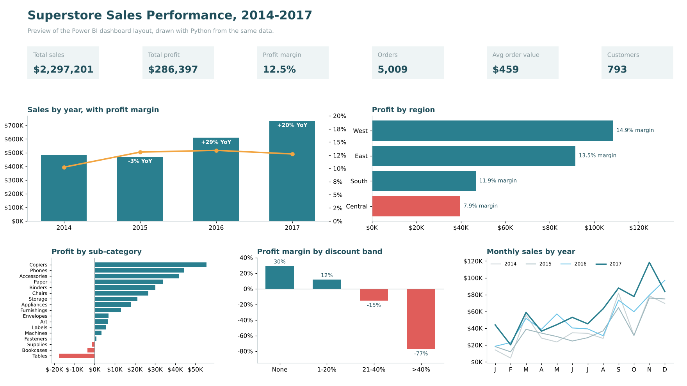

# Sales Performance Dashboard | Power BI, SQL, Excel

An end-to-end sales analysis of a US retail superstore: raw CSV → cleaned **MySQL star schema** → **Excel** analysis workbook → **Power BI** dashboard.



*Preview of the dashboard layout, drawn with Python from the same data. Build the Power BI version using `powerbi/Power_BI_Build_Guide.md`.*

---

## Business questions

1. How are sales, profit and margin trending year over year?
2. Which regions, segments and categories drive profit, and which lag?
3. Which sub-categories lose money, and why?
4. How do discounts affect profitability?
5. Is there seasonality the business should plan for?

## Dataset

**Sample Superstore**: 9,994 order lines, 5,009 orders, 793 customers and 1,862 products, from Jan 2014 to Dec 2017. Columns cover order and ship dates, customer and segment, location, product hierarchy, sales, quantity, discount and profit.
Source: the Tableau sample dataset, taken from the open-source `superstore-arrow` package (MIT licence).

## Tools

| Step | Tool | What I did |
|---|---|---|
| Storage and modelling | MySQL | Staging table, data-quality checks, star schema (1 fact + 4 dimensions) |
| Analysis | SQL | CTEs, window functions (`LAG`, `RANK`, `DENSE_RANK`, running totals), aggregations |
| Reporting | Excel | Formula-driven workbook (`SUMIFS`, `COUNTIFS`, `AVERAGEIFS`), conditional formatting, charts |
| Dashboard | Power BI | Star-schema model, DAX measures incl. time intelligence, interactive visuals and slicers |

## Project structure

```
Sales_Performance_Dashboard/
├── data/
│   └── superstore_raw.csv            raw dataset
├── sql/
│   ├── 01_create_schema.sql          database, staging table, star schema
│   ├── 02_load_and_clean.sql         load CSV, quality checks, build dimensions and fact
│   └── 03_analysis_queries.sql       10 business queries
├── excel/
│   └── Superstore_Sales_Analysis.xlsx
├── powerbi/
│   ├── model_data/                   star-schema tables exported as CSV
│   ├── DAX_measures.dax              all measures used in the dashboard
│   └── Power_BI_Build_Guide.md       step-by-step build instructions
└── images/
    └── dashboard_preview.png
```

## How to run

**SQL** (MySQL 8+; also tested on MariaDB 10.11). Run from this folder:

```bash
mysql -u root -p < sql/01_create_schema.sql
mysql --local-infile=1 -u root -p < sql/02_load_and_clean.sql
mysql -u root -p < sql/03_analysis_queries.sql
```

If `LOAD DATA LOCAL INFILE` is refused, run `SET GLOBAL local_infile = 1;` once as an admin user. In MySQL Workbench, open each file and run it, with `OPT_LOCAL_INFILE=1` set under connection > Advanced.

**Excel:** open `excel/Superstore_Sales_Analysis.xlsx`. Every report figure is a live formula over the `Orders` sheet.

**Power BI:** follow `powerbi/Power_BI_Build_Guide.md`.

## Data cleaning and modelling

- **Validated** row count (9,994), missing values (none), invalid values (no negative sales, no ship date before order date) and duplicates.
- **Found** one order line that appears twice (order `US-2014-150119`). I kept both lines, since the same item can be entered twice on one order, and flagged it for review.
- **Found** that `Product ID` is not unique: 32 IDs map to two different product names. I gave `dim_product` a surrogate key on (ID, name) so no sales are mis-attributed (1,894 product rows).
- **Built** a continuous date dimension (1,464 days) so time-intelligence measures work.
- **Reconciled** the fact table against staging: 9,994 lines, $2,297,200.86 sales and $286,397.02 profit in both.

## Key findings

| KPI | Value |
|---|---|
| Total sales | $2,297,201 |
| Total profit | $286,397 |
| Profit margin | 12.5% |
| Orders | 5,009 |
| Average order value | $459 |

1. **Strong growth after a flat 2015.** Sales fell 2.8% in 2015, then grew **29.5% in 2016** and **20.4% in 2017** (to $733K). Margin held at 12.7–13.4% from 2015 on.
2. **West and East earn 70% of profit.** West has the best margin (14.9%). **Central** sells more than South but has the weakest margin (**7.9%**).
3. **Three sub-categories lose money:** Tables (**–$17,725**), Bookcases (–$3,473) and Supplies (–$1,189). Tables and Bookcases carry the highest average discounts in Furniture (26% and 21%). As a result, Furniture earns just 2.5% margin on $742K of sales.
4. **Heavy discounting destroys profit.** Undiscounted lines earn a **29.5%** margin, and lines discounted 1–20% earn 11.9%. Above 20%, every band loses money: **–15%** margin at 21–40% and **–77%** above 40%. These lines are only 14% of all order lines but lose **$135K**, nearly half of total profit.
5. **Clear Q4 seasonality.** Sales peak in September, November and December every year. November 2017 was the best month on record ($118K).
6. **Copiers, Phones and Accessories** are the most profitable sub-categories. Copiers earn a 37% margin.

## Recommendations

- **Cap discounts at 20%**, especially on Tables, Bookcases and Machines, and review the pricing rules that allow deeper cuts.
- **Investigate the Central region.** Compare its discount levels and product mix with the West's.
- **Plan inventory and staffing for September to December**, and push high-margin Technology lines in those months.
- **Fix the product master data** so each Product ID maps to one product.

## Skills demonstrated

Data cleaning and validation · dimensional modelling (star schema) · SQL CTEs and window functions · Excel formula-driven reporting · DAX measures and time intelligence · dashboard design · turning analysis into recommendations

---
**Author:** Ashik Dev A S · [LinkedIn](https://www.linkedin.com/in/ashik-dev-301b63252)
